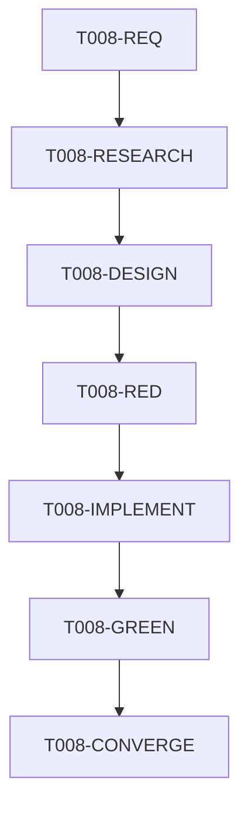

# T008 — Dependency-ordered tasks

## Tasks

### T008-REQ — Record requirements

- **Depends on:** none
- **Covers:** FR-001–FR-006, NFR-001–NFR-004
- **Deliverable:** `requirements.md` covering scope, constraints, acceptance
  criteria, and unresolved SDK provenance.
- **Acceptance:** Requirements include FR-001 through FR-006, NFR-001 through
  NFR-004, and explicit Docker/SDK blockers.
- **Validation:** Review against the user request and acceptance criteria.
- **Status:** complete

### T008-RESEARCH — Resolve build-input unknowns

- **Depends on:** T008-REQ
- **Covers:** FR-001–FR-006, NFR-001–NFR-004
- **Deliverable:** `research.md` with repository evidence, Docker/Compose
  evidence, alternatives, and the selected smallest design.
- **Acceptance:** The selected design is supported by authoritative
  Docker/Compose named-context behavior and rejects the implicit directory.
- **Validation:** Confirm Docker named-context and Compose
  `additional_contexts` behavior from authoritative documentation.
- **Status:** complete

### T008-DESIGN — Define the build contract

- **Depends on:** T008-RESEARCH
- **Covers:** FR-001–FR-006, NFR-001–NFR-004
- **Deliverable:** `design.md` with Dockerfile, Compose, test, failure, and
  traceability decisions.
- **Acceptance:** Every functional and non-functional requirement maps to a
  design element without changing runtime paths.
- **Validation:** Confirm all FR/NFR requirements have a design element.
- **Status:** complete

### T008-RED — Add and run the regression test before production changes

- **Depends on:** T008-DESIGN
- **Covers:** FR-005, NFR-003, NFR-004
- **Deliverable:** Focused static build-contract test that encodes the explicit
  contract.
- **Acceptance:** The test fails before the Docker/Compose production change
  and checks the explicit context, runtime paths, docs, and SDK ignore rule.
- **Validation:** The test must fail against the unchanged `6021a43` Dockerfile.
- **Status:** complete — `go test . -run TestDaemonDockerBuildContract -count=1`
  failed as expected on the unchanged implicit Docker/Compose contract.

### T008-IMPLEMENT — Implement the explicit SDK build contract

- **Depends on:** T008-RED
- **Covers:** FR-001–FR-004, FR-006, NFR-001–NFR-003
- **Deliverable:** Dockerfile named context, Compose declarations, and related
  operator documentation/environment template.
- **Acceptance:** No unqualified SDK-directory copy remains; both daemon
  Compose builds require the explicit input; no SDK bytes or credentials are
  added.
- **Validation:** Static contract test passes; no SDK or credentials are
  tracked; runtime path declarations remain unchanged.
- **Status:** complete — Dockerfile, both daemon Compose builds, `.env.example`,
  and README now use the explicit private SDK input.

### T008-GREEN — Run formatting and repository validation

- **Depends on:** T008-IMPLEMENT
- **Covers:** NFR-004
- **Deliverable:** gofmt output and passing focused/repository Go tests.
- **Acceptance:** Focused test and `go test ./...` pass; Docker limitations are
  recorded rather than hidden.
- **Validation:** `gofmt`, targeted build-contract test, `go test ./...`, and
  Dockerfile/Compose inspection when Docker is unavailable.
- **Status:** complete — focused contract test and `go test ./...` pass;
  `gofmt -l` is clean; Compose config validates with supplied dummy variables;
  Docker build is unavailable because the local engine is stopped.

### T008-CONVERGE — Converge and self-review

- **Depends on:** T008-GREEN
- **Covers:** all requirements and acceptance criteria
- **Deliverable:** Updated `STATUS.md`, clean requirement traceability, isolated
  diff, and PR-ready commit.
- **Acceptance:** No unresolved requirement gaps or stale status claims remain;
  the commit is isolated and not pushed.
- **Validation:** Review diff, run convergence checklist, commit without push or
  PR creation.
- **Status:** complete — requirements, design, implementation, tests, and
  documentation are aligned; no remaining convergence tasks.

## Dependency graph

## Adjacency list

- `T008-REQ`: depends on `none`; unlocks `T008-RESEARCH`
- `T008-RESEARCH`: depends on `T008-REQ`; unlocks `T008-DESIGN`
- `T008-DESIGN`: depends on `T008-RESEARCH`; unlocks `T008-RED`
- `T008-RED`: depends on `T008-DESIGN`; unlocks `T008-IMPLEMENT`
- `T008-IMPLEMENT`: depends on `T008-RED`; unlocks `T008-GREEN`
- `T008-GREEN`: depends on `T008-IMPLEMENT`; unlocks `T008-CONVERGE`
- `T008-CONVERGE`: depends on `T008-GREEN`; final validation gate
