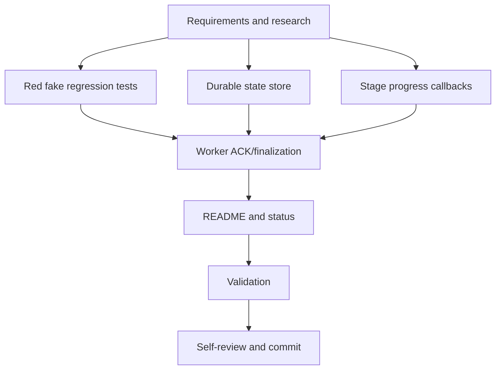

# T011 Tasks

## Dependency graph

## Setup and foundational tasks

- [x] T001 Complete requirements, research, design, plan, spec, data model,
  quickstart, checklist, and status artifacts in
  `.specify/specs/t011-daemon-onboarding-state/`.
- [x] T002 Add red fake onboarding regression tests for invalid OTP, provider
  outage, success, retry, and no-ACK-on-state-write-failure in
  `cmd/daemon/worker_test.go` and `processor/onboard_schema_test.go`.

## Implementation tasks

- [x] T003 Implement T010-compatible guarded queue/progress/failure/completion
  writes for both `branch_zatca_config` and `zatca_onboarding_attempt` in
  `cmd/daemon/onboarding_state.go`.
- [x] T004 Add progress-aware onboarding wrappers reporting CSR, compliance,
  invoices, and production in `processor/onboard.go` and `zatca/zatca.go`.
- [x] T005 Integrate durable state, error classification, failure ACK ordering,
  and done-before-activation behavior in `cmd/daemon/worker.go` and
  `cmd/daemon/onboarding_state.go`.
- [x] T006 Document the migration and write-connection runtime dependency and
  no-OTP behavior in `README.md`; update `STATUS.md`.

## Validation and completion

- [x] T007 Run `gofmt`, targeted daemon/processor/ZATCA tests, `go vet ./...`,
  `go test ./...`, and `git diff --check`.
- [x] T008 Review the complete isolated diff and create the T011 commit with
  the required Copilot co-author trailer; do not push or open a PR. Commit:
  `cf1553c`.

## Adjacency list

- `T001 -> T002, T003, T004`
- `T002 + T003 + T004 -> T005`
- `T005 -> T006 -> T007 -> T008`

## Parallel-ready work

T002, T003, and T004 were independently designable, but implementation stayed
in one worktree and was completed sequentially to avoid conflicting writers.

## MVP and independent tests

- MVP: T003 + T004 + T005, with T002's fake onboarding tests.
- Failure story: `go test ./cmd/daemon -run 'TestOnboard'`.
- T029 compatibility story: `go test ./processor -run 'TestOnboardSQL'`.
- Repository gate: `go test ./...`.
