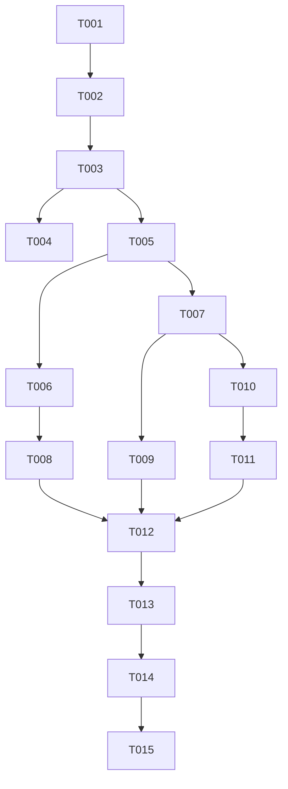

# T017 Tasks

## Phase 1: Setup

- [x] T001 Confirm the clean `6021a43` baseline and preserve the T017 feature artifacts under `.specify/specs/t017-pih-icv-state/`.
- [x] T002 Record the backend T016 integration dependency and repository-local `zatca_chain_position` contract in `scripts/migration_zatca_schema.sql` and `README.md`.

## Phase 2: Foundational

- [x] T003 Define `ChainStateStore`, `ChainPosition`, and document-type identity in `processor/chain_state.go`.
- [x] T004 [P] Add deterministic in-memory chain-state tests for branch isolation and shared invoice/credit/debit allocation in `processor/chain_state_test.go`.

## Phase 3: User Story 1 — Continue a branch sequence (P1)

- [x] T005 [US1] Implement transactional MySQL reservation and accepted commit in `processor/chain_state.go`, including stable UUID/issue time/signed payload persistence and explicit missing-state errors.
- [x] T006 [US1] Refactor production document builders in `processor/bill.go`, `processor/credit.go`, and `processor/debit.go` to remove fixed PIH/ICV values and apply a reserved position.
- [x] T007 [US1] Refactor the shared submission pipeline in `processor/bill.go` to save prepared payloads, classify accepted responses, and commit document plus branch state atomically.
- [x] T008 [US1] Add XML regression coverage for non-default PIH/ICV and digit-only ICV output in `invoice/xml_test.go`.
- [x] T009 [US1] Add processor regression coverage for non-default builder state, retry reuse, failed-state preservation, duplicate accepted commits, and out-of-order protection in `processor/chain_state_test.go`.

## Phase 4: User Story 2 — Serialize mixed document types (P1)

- [x] T010 [US2] Add a wildcard branch subject/consumer name in `queue/message.go` and route all document messages for one tenant/branch through one daemon worker in `cmd/daemon/main.go` and `cmd/daemon/worker.go`.
- [x] T011 [US2] Update daemon worker-count and chain-state integration documentation in `README.md`.

## Phase 5: Polish and Cross-Cutting Validation

- [x] T012 [P] Run the required red test before implementation and record the failure in `.specify/specs/t017-pih-icv-state/STATUS.md`.
- [x] T013 Run `gofmt` on changed Go files and targeted tests `go test ./invoice ./processor`.
- [x] T014 Run `go test ./...` and `go vet ./...`; fix only T017-caused failures.
- [ ] T015 Run Spec Kit convergence/self-review, reconcile `STATUS.md`, inspect the final diff, and create the isolated commit with the required Co-authored-by trailer.

## Dependencies

Adjacency list:

- T001: none.
- T002: T001.
- T003: T002.
- T004: T003.
- T005: T003.
- T006: T005.
- T007: T005.
- T008: T006.
- T009: T007.
- T010: T007.
- T011: T010.
- T012: T008, T009, T011.
- T013: T012.
- T014: T013.
- T015: T014.

## Parallel Opportunities

- T004 can run independently after T003.
- T005 and the initial XML/test design can be reviewed in parallel, but source
  writers must not edit the same Go files concurrently.
- T008 and T009 are independent test files after their implementation
  dependencies complete.

## Independent Story Tests

- US1: `go test ./invoice ./processor` proves non-default state, stable
  reservations, and accepted-state transitions without a live provider.
- US2: queue/daemon review plus the full test suite proves one mixed-document
  consumer is wired per branch and existing subjects remain publishable.

## MVP

US1 (T003–T009) is the minimum safe implementation. US2 is required before
daemon rollout because three independent consumers would still violate the
shared branch sequence.
