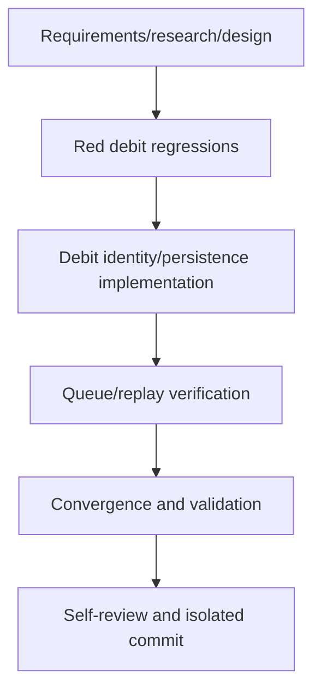

# T025 Tasks

## Dependency graph

## Dependency-ordered tasks

- [x] T025-1: Create requirements, research, design, plan, and status
  artifacts. Depends on: none. Validate: all artifacts exist and agree.
- [x] T025-2: Add focused debit processor regressions for original bill
  reference, T024 source query/replay, and accepted artifact persistence.
  Depends on: T025-1. Validate: targeted red run fails against the current
  implementation.
- [x] T025-3: Implement only the debit identity and artifact persistence
  corrections needed by the tests, preserving T017 chain and existing retry
  flow. Depends on: T025-2. Validate: targeted debit tests pass.
- [x] T025-4: Verify queue subject, branch worker, and startup replay use
  `queue.DocDebit` with debit-note IDs. Depends on: T025-3. Validate:
  queue/replay targeted tests pass and no unsupported path remains.
- [x] T025-5: Run convergence and validation. Depends on: T025-4. Validate:
  `gofmt`, targeted tests, `go test ./...`, `go vet ./...`, and diff check.
- [ ] T025-6: Self-review scope, docs, schema dependency, and commit. Depends
  on: T025-5. Validate: clean isolated commit, no push/PR.

## Adjacency list

- T025-1: []
- T025-2: [T025-1]
- T025-3: [T025-2]
- T025-4: [T025-3]
- T025-5: [T025-4]
- T025-6: [T025-5]
