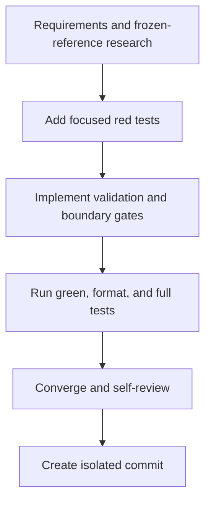

# T027 Tasks

## Dependency graph

## Adjacency list

- `T027-1`: depends on none; validation is the research/spec baseline.
- `T027-2`: depends on `T027-1`; add tests that fail on `6021a43`.
- `T027-3`: depends on `T027-2`; implement only the strict validation gates.
- `T027-4`: depends on `T027-3`; run gofmt and targeted/full Go tests.
- `T027-5`: depends on `T027-4`; inspect diff, scope, docs, and convergence.
- `T027-6`: depends on `T027-5`; commit without push or PR creation.

## Deliverables

- [x] **T027-1** — Requirements, research, design, plan, and task graph
  covering the frozen ZATCA/SPL references.
- [x] **T027-2** — Config/onboarding regression tests for invalid VAT digits,
  VAT boundary digits, malformed location, and required fields; red recorded
  with `go test ./config ./processor` on the baseline.
- [x] **T027-3** — Strict validation and pre-provider gates in config,
  processor, SDK, and service onboarding boundaries.
- [x] **T027-4** — Gofmt, targeted tests, and `go test ./...` green.
- [x] **T027-5** — Spec convergence and self-review; no state-machine or schema
  cleanup changes found.
- [x] **T027-6** — Isolated commit created on
  `fix/zatca/m1-daemon-validation`; no push or PR created.

## Validation commands

- Red/targeted: `go test ./config ./processor`
- Format: `gofmt -w config/*.go processor/*.go sdk/*.go zatca/*.go`
- Green/targeted: `go test ./config ./processor ./sdk ./zatca`
- Repository gate: `go test ./...`
- Scope review: `git diff --check` and `git status --short`
