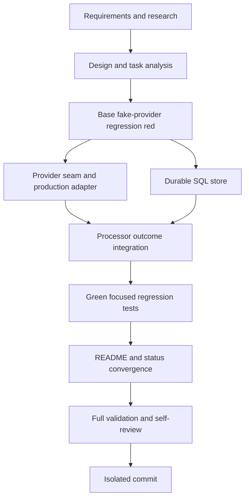

# T004 Tasks

## Dependency Graph

T004D and T004E are logically independent implementation areas, but they share
processor package contracts and must be applied sequentially in this one
worktree. T004F is the foundational integration blocker. T004I is the final
validation gate.

## Dependency-Ordered Tasks

### T004A — Specify and research (done)

- **Deliverable:** `requirements.md` and `research.md` with T003 names,
  provider semantics, tenant mapping, and explicit note-schema blocker.
- **Depends on:** none.
- **Acceptance:** no source code changed before requirements/research.
- **Validation:** inspect artifacts and read-only T003 worktree status.

### T004B — Design and analysis (done)

- **Deliverable:** `design.md`, `tasks.md`, `STATUS.md`, `spec.md`, `plan.md`,
  and quality checklist.
- **Depends on:** T004A.
- **Acceptance:** provider, persistence, failure, compatibility, and test
  decisions agree across artifacts.
- **Validation:** checklist review; no unresolved silent fallback.

### T004C — Add base regression and prove red

- **Deliverable:** focused processor fake-provider regression tests for
  accepted, warning, rejected, timeout/ambiguous, and nil outcomes.
- **Depends on:** T004B.
- **Acceptance:** tests fail at base `6021a43` because the provider seam/
  durable outcome behavior is absent or non-success issuance is incorrect.
- **Validation:** `go test ./processor -run 'TestProcessBill.*Outcome' -count=1`
  at base, with exact red output recorded in `STATUS.md`.

### T004D — Add provider seam and adapter

- **Deliverable:** narrow provider/result/error types, production adapter over
  existing `zatca.Service`, response/error classification, and deterministic
  document UUID helper.
- **Depends on:** T004C.
- **Acceptance:** existing runtime APIs compile unchanged; fakes can supply
  all required outcomes without SDK/HTTP.
- **Validation:** `gofmt -w processor/*.go config/config.go cmd/daemon/main.go`;
  `go test ./processor -run 'TestProvider|TestStable' -count=1`.

### T004E — Add T003 durable SQL store

- **Deliverable:** parameterized transactional start/finish persistence for
  submission, attempt, outcome, and artifact rows; exact schema errors are
  returned; no legacy fallback.
- **Depends on:** T004C.
- **Acceptance:** exact T003 columns/tables are used; attempts are monotonic;
  tenant ID is numeric and artifact paths remain tenant-scoped.
- **Validation:** `go test ./processor -run 'TestSubmissionStore' -count=1`
  and static SQL identifier review.

### T004F — Integrate processing and legacy state safety

- **Deliverable:** shared bill sign/submit flow records pending/final outcome,
  UUID/hash/QR/request/cleared artifacts, and conditionally updates bill state.
  Note paths fail explicitly on the T003 bill-only blocker.
- **Depends on:** T004D, T004E.
- **Acceptance:** non-success outcomes never write `state=3`; accepted outcomes
  do; provider errors are returned after durable completion.
- **Validation:** focused processor tests plus `go test ./processor`.

### T004G — Make focused regression green

- **Deliverable:** assertions for all requested fake-provider branches,
  provider fields, attempts, artifacts, tenant context, and state updates.
- **Depends on:** T004F.
- **Acceptance:** the same test suite that was red at base passes.
- **Validation:** `go test ./processor -run 'TestProcessBill.*Outcome' -count=1`.

### T004H — Update documentation and status

- **Deliverable:** README processing pipeline/outcome behavior and current
  `STATUS.md`; record T003 prerequisite and note/grant limitations.
- **Depends on:** T004G.
- **Acceptance:** no stale claim that every response is issued; status headings
  reconcile with this task list.
- **Validation:** inspect README/spec artifacts and `git diff --check`.

### T004I — Validate and self-review

- **Deliverable:** formatted, targeted-tested, full-tested, reviewed worktree.
- **Depends on:** T004H.
- **Acceptance:** gofmt and targeted tests pass; `go test ./...` passes or
  exact blockers are recorded.
- **Validation:** `gofmt -l .`; targeted processor tests; `go test ./...`;
  inspect diff and T003 worktree remains clean.

### T004J — Commit isolated PR-ready changes

- **Deliverable:** one commit on `fix/zatca/c2-submission-state-daemon`.
- **Depends on:** T004I.
- **Acceptance:** only T004 files are committed; no push/PR; required
  co-author trailer is present.
- **Validation:** `git status --short --branch`; `git show --stat --format=fuller HEAD`.

## Adjacency List

- T004A: none
- T004B: T004A
- T004C: T004B
- T004D: T004C
- T004E: T004C
- T004F: T004D, T004E
- T004G: T004F
- T004H: T004G
- T004I: T004H
- T004J: T004I

## Risks and blockers

- T003's `UNIQUE (bill_id)` cannot independently represent note documents.
- The existing daemon privilege script lacks T003 write grants. The exact
  required grants must be documented; schema/permission failures must not be
  swallowed.
