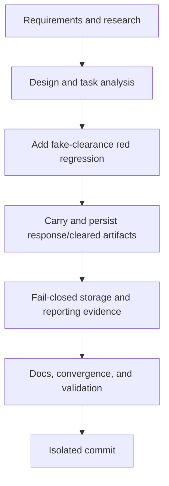

# Tasks: T006 Cleared Artifact

## Dependency graph

## Dependency-ordered tasks

### T006A — Specify and research

- **Depends on:** none.
- **Deliverable:** `requirements.md` and `research.md`.
- **Validation:** inspect T003/T004 contract and current processor flow.

### T006B — Design and analysis

- **Depends on:** T006A.
- **Deliverable:** `design.md`, `tasks.md`, and `STATUS.md`.
- **Validation:** requirement/design traceability and no schema migration.

### T006C — Add fake-clearance red regression

- **Depends on:** T006B.
- **Deliverable:** processor test proving returned cleared XML is retained.
- **Validation:** focused test fails against `670be54`.

### T006D — Carry and persist response/cleared artifacts

- **Depends on:** T006C.
- **Deliverable:** processor/provider/store contract changes for cleared XML,
  response evidence, paths, references, and artifact rows.
- **Validation:** focused regression and existing processor tests.

### T006E — Fail-closed storage and reporting evidence

- **Depends on:** T006D.
- **Deliverable:** explicit artifact-store errors and reporting response
  retention without changing T004 outcome/retry semantics.
- **Validation:** focused storage-failure test and processor suite.

### T006F — Documentation, convergence, and validation

- **Depends on:** T006E.
- **Deliverable:** README/status updates, formatted and self-reviewed code.
- **Validation:** `gofmt`, `go test ./...`, `go vet ./...`, diff review.

### T006G — Isolated commit

- **Depends on:** T006F.
- **Deliverable:** one commit on `fix/zatca/c3-cleared-artifact`; no push/PR.
- **Validation:** clean status and commit stat.

## Adjacency list

- T006A: none
- T006B: T006A
- T006C: T006B
- T006D: T006C
- T006E: T006D
- T006F: T006E
- T006G: T006F
