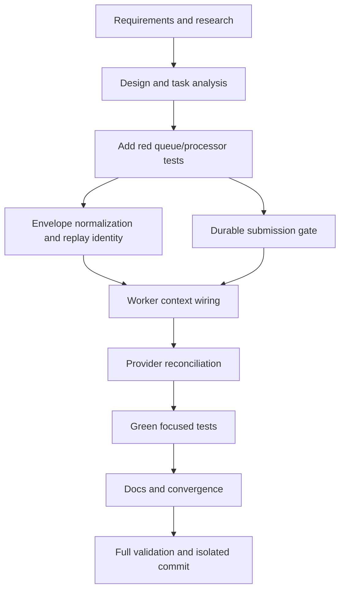

# T015 Tasks

## Dependency graph

## Dependency-ordered tasks

### T015A — Specify and research (done)

- **Deliverable:** requirements and research with T014/T004 evidence.
- **Depends on:** none.
- **Validation:** inspect artifacts and read-only backend status.

### T015B — Design and analysis (done)

- **Deliverable:** design, graph, status, spec, and plan aligned.
- **Depends on:** T015A.
- **Validation:** requirement/design traceability review.

### T015C — Add focused red regressions

- **Deliverable:** queue envelope, duplicate-delivery, and
  timeout-after-acceptance fake tests.
- **Depends on:** T015B.
- **Acceptance:** tests fail at `670be54` because T014 fields are ignored,
  replay identity differs, duplicate state is not consulted, and no
  reconciliation hook exists.
- **Validation:** targeted queue/processor test commands with red output
  recorded in `STATUS.md`.

### T015D — Normalize envelope and replay identity

- **Deliverable:** additive `queue.Message` fields/helpers and replay
  publication using stable `Nats-Msg-Id`.
- **Depends on:** T015C.
- **Validation:** `gofmt` and queue/daemon targeted tests.

### T015E — Add durable submission gate

- **Deliverable:** state lookup/lock, accepted/in-flight short-circuit,
  stable provider UUID context, and artifact correlation metadata.
- **Depends on:** T015C.
- **Validation:** processor duplicate tests and SQL identifier review.

### T015F — Wire worker message context

- **Deliverable:** copy T014 identity/attempt context into processor config
  without mutating cached branch config.
- **Depends on:** T015D, T015E.
- **Validation:** worker context tests and processor stable UUID tests.

### T015G — Add provider reconciliation

- **Deliverable:** optional provider reconciler, ambiguous lookup gate,
  provider limitation error, and safe same-identity resubmission after
  not-found.
- **Depends on:** T015F.
- **Validation:** timeout-after-acceptance and not-found fake tests.

### T015H — Make focused regressions green

- **Deliverable:** all T015 tests pass; existing T004 tests remain green.
- **Depends on:** T015G.
- **Validation:** targeted queue/processor/daemon tests.

### T015I — Documentation and convergence

- **Deliverable:** README and STATUS/spec artifacts updated with limitations;
  no T020/T017 scope creep.
- **Depends on:** T015H.
- **Validation:** `git diff --check` and artifact consistency review.

### T015J — Validate and commit

- **Deliverable:** formatted, tested, reviewed isolated T015 commit.
- **Depends on:** T015I.
- **Validation:** `gofmt -l`, targeted tests, `go test ./...`, `go vet ./...`,
  diff review, `git status`, commit without push/PR.

## Adjacency list

- T015A: none
- T015B: T015A
- T015C: T015B
- T015D: T015C
- T015E: T015C
- T015F: T015D, T015E
- T015G: T015F
- T015H: T015G
- T015I: T015H
- T015J: T015I

## Risks and blockers

- T003 has no dedicated stable-key/outbox/attempt columns; T015 uses
  `document_id` plus request artifact JSON metadata.
- The current production provider has no lookup endpoint; ambiguous outcomes
  remain ambiguous rather than being blindly resubmitted.
- Credit/debit persistence remains blocked by T004's bill-keyed schema.
