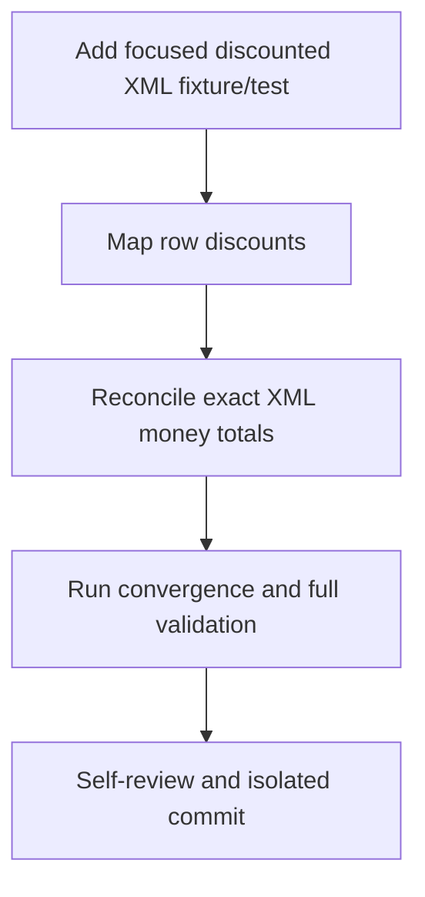

# T018 Tasks

## Dependency graph

## Dependency-ordered tasks

- [x] **T018-1** — Add the fixture regression and prove it red on the
  prerequisite base. Validation: `go test ./processor -run TestBuildBillInvoiceDiscountFixture -count=1`.
- [x] **T018-2** — Preserve bill/product discounts through row and builder
  mapping. Depends on: T018-1. Validation: focused processor test.
- [x] **T018-3** — Reconcile decimal-safe line, tax, allowance, and legal
  totals in UBL. Depends on: T018-2. Validation: focused invoice and processor
  tests.
- [x] **T018-4** — Run gofmt, targeted tests, full suite, and artifact
  consistency/convergence review. Depends on: T018-3. Validation: commands in
  `STATUS.md`.
- [x] **T018-5** — Self-review scope, migration dependency, and commit. Depends
  on: T018-4. Validation: clean status and isolated commit.

## Adjacency list

- T018-1: none
- T018-2: T018-1
- T018-3: T018-2
- T018-4: T018-3
- T018-5: T018-4

No tasks are marked parallel because all implementation tasks touch the same
invoice/processor flow.
