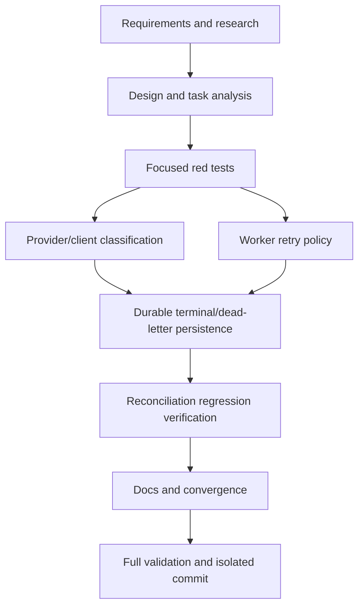

# T020 Tasks

## Dependency graph

## Dependency-ordered tasks

### T020A — Specify and research (done)

- **Deliverable:** `requirements.md` and `research.md`.
- **Depends on:** none.
- **Validation:** inspect repository seams, durable fields, and baseline tests.

### T020B — Design and task analysis (done)

- **Deliverable:** `design.md`, `plan.md`, `tasks.md`, and `STATUS.md`.
- **Depends on:** T020A.
- **Validation:** requirement/design traceability and scope review.

### T020C — Add focused red regressions (done)

- **Deliverable:** worker/provider/client fake tests for permanent,
  transient, terminal, and timeout reconciliation behavior.
- **Depends on:** T020B.
- **Acceptance:** tests fail at `d7bbc1a` because the worker retries generic
  errors and provider outcomes do not distinguish terminal retry exhaustion.
- **Validation:** targeted test commands with red output recorded in status.

### T020D — Classify provider/client failures (done)

- **Deliverable:** explicit retryable/permanent/terminal classification for
  API status, transport, timeout, malformed XML, and invalid provider results.
- **Depends on:** T020C.
- **Acceptance:** ordinary 4xx and invalid XML are non-retryable; temporary
  statuses and transport uncertainty are retryable.
- **Validation:** processor/provider and client fake tests.

### T020E — Implement worker retry policy (done)

- **Deliverable:** injectable retry loop, incremented attempt metadata, no
  retry for permanent errors, bounded transient retries, final context.
- **Depends on:** T020C.
- **Acceptance:** worker tests prove one permanent attempt and bounded
  transient attempts without long sleeps.
- **Validation:** `go test ./cmd/daemon`.

### T020F — Persist terminal/dead-letter outcomes (done)

- **Deliverable:** retry-aware durable outcome timestamps, terminal exhaustion,
  and permanent/terminal duplicate gating through existing SQL contract.
- **Depends on:** T020D, T020E.
- **Acceptance:** terminal/dead-letter states have nil next retry and retain
  attempt/error evidence.
- **Validation:** processor fake-store tests and SQL identifier review.

### T020G — Verify timeout reconciliation (done)

- **Deliverable:** preserve/extend timeout-after-acceptance and provider lookup
  limitation tests; no blind resubmission.
- **Depends on:** T020F.
- **Acceptance:** one submit + one reconcile for acceptance; unsupported
  lookup remains explicit ambiguous.
- **Validation:** processor idempotency tests.

### T020H — Documentation and convergence (done)

- **Deliverable:** README plus complete, current T020 artifacts and status.
- **Depends on:** T020G.
- **Acceptance:** retry/dead-letter policy and provider limitation are
  documented; no PIH/ICV/XML/UI changes.
- **Validation:** `git diff --check` and artifact consistency review.

### T020I — Full validation and isolated commit (in progress)

- **Deliverable:** formatted, tested, reviewed T020 commit; no push/PR.
- **Depends on:** T020H.
- **Acceptance:** `gofmt`, targeted tests, `go test ./...`, `go vet ./...`,
  and isolated diff review pass or exact blockers are recorded.
- **Validation:** commands and `git status` recorded in `STATUS.md`.

## Adjacency list

- T020A: none
- T020B: T020A
- T020C: T020B
- T020D: T020C
- T020E: T020C
- T020F: T020D, T020E
- T020G: T020F
- T020H: T020G
- T020I: T020H

## Risks and blockers

- The current production provider has no lookup-by-UUID endpoint; runtime
  reconciliation remains explicitly unsupported.
- The durable T003 schema has no dedicated `dead_letter` state; terminal
  failure plus error fields and a null next retry is the compatible form.
