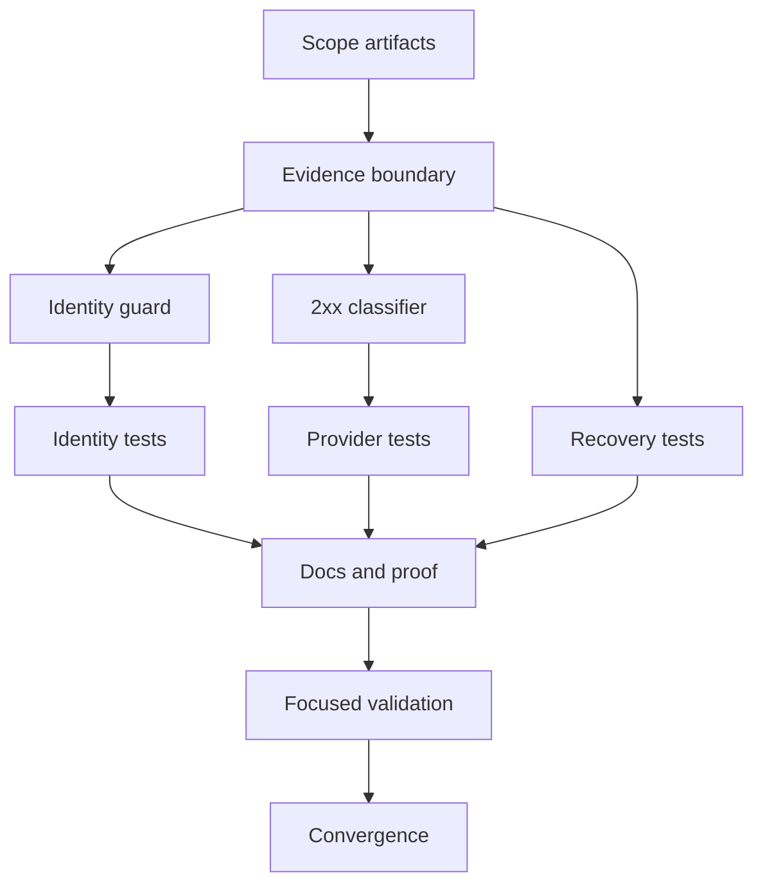

# Tasks: PR33 D10 Identity and Recovery

## Dependency graph

## Phase 1 — Setup

- [x] T001 Confirm the scoped requirements, research, design, data model, and
  status artifacts in `specs/021-pr33-d10-recovery/`.

## Phase 2 — Foundational

- [x] T002 Record the external-evidence boundary and existing tenant schema
  assumptions in `specs/021-pr33-d10-recovery/research.md` and
  `specs/021-pr33-d10-recovery/STATUS.md`.

## Phase 3 — User Story 1: Document identity (P1)

**Independent test criteria:** A bill with sequence `BR-007-0042` emits that
value as XML `cbc:ID`, while the bill row ID and booked ICV remain different;
a missing sequence is rejected before booking.

- [x] T003 [US1] Require a non-empty trimmed `sequence_number` before booking
  and use it as the XML document ID in `processor/bill.go`.
- [x] T004 [US1] Add builder and validation regressions for sequence-derived
  XML identity and missing sequence in `processor/bill_test.go`.

## Phase 4 — User Story 2: Recovery and provider outcomes (P1)

**Independent test criteria:** Clean/warning/error 2xx responses classify
correctly; 409 is ambiguous; a committed invoice is retried from the exact
stored XML; a recorded outcome is never submitted again.

- [x] T005 [US2] Classify explicit invoice error/status signals in successful
  provider responses as non-accepting in `processor/bill.go`.
- [x] T006 [US2] Extend provider classification tests for explicit 2xx errors
  and failed validation status in `processor/bill_test.go`.
- [x] T007 [US2] Add a record-failure/redelivery regression that changes a
  provider acceptance replay into an ambiguous 409 without rebuilding the
  stored invoice in `queue/ordered_stream_test.go`.

## Phase 5 — User Story 3: Local proof (P2)

**Independent test criteria:** Focused tests run without provider credentials
and prove durable-before-ACK and operator-reconciliation behavior.

- [x] T008 [US3] Update `README.md` with the identity/recovery contract and
  clearly label sandbox evidence as external.
- [x] T009 [US3] Run focused `gofmt`, `go test`, and `go vet`; record results
  in `specs/021-pr33-d10-recovery/STATUS.md`.

## Phase 6 — Polish and convergence

- [x] T010 Review the diff and all feature artifacts for scope, stale status,
  schema assumptions, and unsupported sandbox claims; run convergence review.

## Adjacency list

- T001: —
- T002: T001
- T003: T002
- T004: T003
- T005: T002
- T006: T005
- T007: T002
- T008: T004, T006, T007
- T009: T008
- T010: T009

## Parallel execution

- T003 and T005 are independent after T002, but they touch the same production
  file and must be performed sequentially in this single worktree.
- T004, T006, and T007 are logically independent test concerns but T004 and
  T006 share `processor/bill_test.go`; keep them sequential.

## Implementation strategy

Deliver the P1 identity and recovery behavior first, then update documentation
and run the validation/convergence gate. No live sandbox dependency is part of
the MVP.
