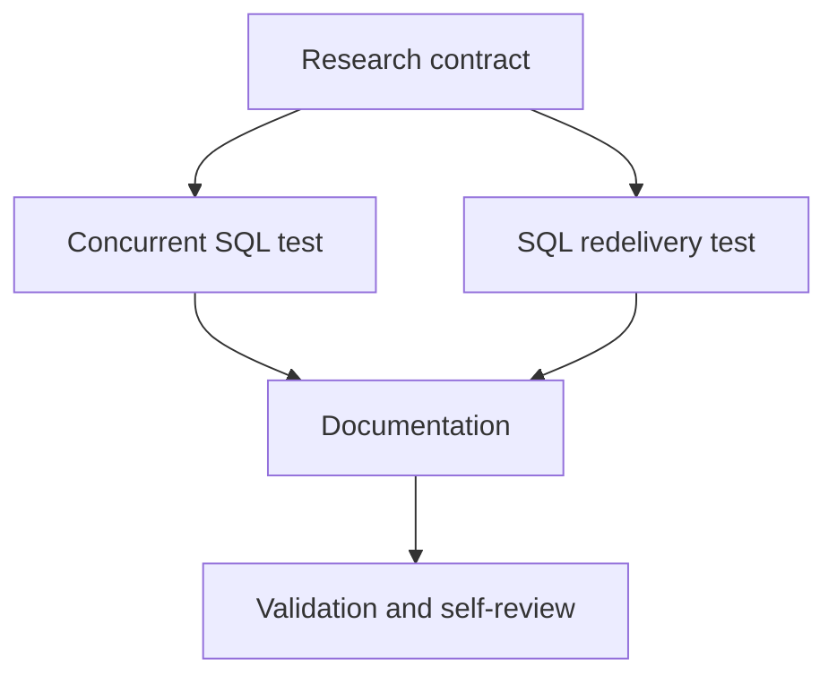

# Tasks: ZATCA Chain Owner and Reservation Contract

## Dependency graph

## Phase 1 — Setup

- [x] T001 Confirm daemon SQL ownership, backend migration evidence, and
  backend-agent handoff in `specs/022-zatca-chain-owner-contract/`.

## Phase 2 — ZATCA chain tests

- [x] T002 Add a MySQL-backed concurrent booking/release/commit regression in
  `queue/sql_test.go`.
- [x] T003 Add a MySQL-backed ordered-stream redelivery regression using
  `queue.SQLChain` and `queue.SQLClaimStore` in `queue/sql_test.go`; adjust
  `queue/ordered_stream_test.go` helpers only if required.

## Phase 3 — Documentation

- [x] T004 Document ZATCA runtime ownership, backend Goose schema ownership,
  reservation-column use, and tenant assumptions in `queue/chain.go` and
  `README.md`.

## Phase 4 — Validation

- [x] T005 Run focused/full Go tests, vet, gofmt, diff scope checks, and
  self-review; confirm no backend worktree files changed.

## Adjacency list

- T001: —
- T002: T001
- T003: T001
- T004: T002, T003
- T005: T004
