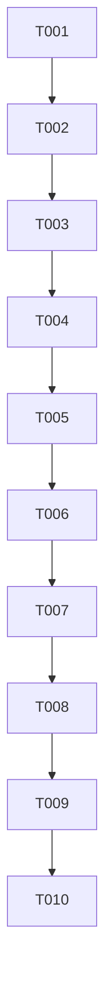

# T029 Tasks: ZATCA OTP Schema Contract

## Phase 1 — Setup

- [x] T001 Record the T029 requirements, repository evidence, and scope boundaries in `specs/029-zatca-otp-schema-contract/requirements.md`, `specs/029-zatca-otp-schema-contract/research.md`, and `specs/029-zatca-otp-schema-contract/spec.md`.
- [x] T002 Record the implementation design, data model, validation guide, and plan in `specs/029-zatca-otp-schema-contract/design.md`, `specs/029-zatca-otp-schema-contract/data-model.md`, `specs/029-zatca-otp-schema-contract/quickstart.md`, and `specs/029-zatca-otp-schema-contract/plan.md`.

## Phase 2 — Foundational Contract

- [x] T003 Add the offline executable-SQL schema contract test in `processor/onboard_schema_test.go`, parsing onboarding `Exec` calls and failing when a query writes `zatca_otp`.
- [x] T004 Run the focused red regression `go test ./processor -run TestOnboardSQLDoesNotWriteLegacyOTP -count=1` and record the expected failure in `specs/029-zatca-otp-schema-contract/STATUS.md`.

## Phase 3 — User Story 1: Schema-compatible onboarding (P1)

**Goal**: A successful onboarding does not issue a write against a legacy column absent from the
active backend schema.

**Independent test criteria**: `go test ./processor -run TestOnboardSQLDoesNotWriteLegacyOTP
-count=1` passes, and no executable onboarding SQL contains `zatca_otp`.

- [x] T005 [US1] Remove the obsolete post-success `UPDATE branch_zatca_config SET zatca_otp = ''` call from `processor/onboard.go` without changing credential persistence or onboarding state.
- [x] T006 [US1] Replace the stale daemon cleanup instruction in `scripts/migration_zatca_schema.sql` with the active-schema rationale that the daemon does not write `zatca_otp`.
- [x] T007 [US1] Run the focused green regression `go test ./processor -run TestOnboardSQLDoesNotWriteLegacyOTP -count=1` and verify the contract rejects any future legacy write.

## Phase 4 — Polish and Cross-cutting Validation

- [x] T008 Run `gofmt -w processor/onboard_schema_test.go` and verify formatting for all changed Go files.
- [x] T009 Run targeted `go test ./processor` and full `go test ./...`; record results and any pre-existing blocker in `specs/029-zatca-otp-schema-contract/STATUS.md`.
- [x] T010 Run consistency/convergence/self-review over the spec artifacts and final diff, then create an isolated T029 commit on `fix/zatca/m3-schema-drift` with no push or pull request.

## Dependency Graph

## Adjacency List

- `T001`: no dependencies; foundational requirements.
- `T002`: depends on `T001`; design artifacts.
- `T003`: depends on `T002`; regression contract.
- `T004`: depends on `T003`; mandatory red gate.
- `T005`: depends on `T004`; source fix.
- `T006`: depends on `T005`; related migration documentation.
- `T007`: depends on `T006`; mandatory green gate.
- `T008`: depends on `T007`; formatting.
- `T009`: depends on `T008`; targeted/full validation.
- `T010`: depends on `T009`; convergence, self-review, and isolated commit.

No tasks are marked `[P]`: all implementation tasks share the same onboarding SQL boundary and
must remain serial.

## Implementation Strategy

Deliver the smallest MVP first: the contract test plus removal of the obsolete update. Keep
credential persistence and onboarding state unchanged, then finish with formatting, full test
validation, artifact convergence, and the isolated commit.
