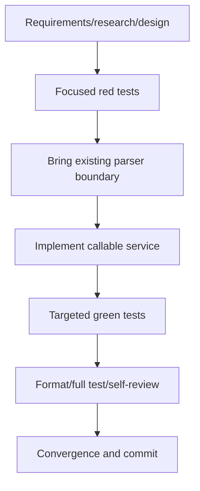

# T030 tasks

## Dependency graph

## Dependency-ordered tasks

### T030-REQ — Record scoped requirements and design

- Depends on: none
- Deliverable: `requirements.md`, `research.md`, `design.md`, `plan.md`.
- Acceptance: scope excludes persistence/UI and documents provider limitation.
- Validation: artifact consistency review.

### T030-RED — Add disconnected-boundary tests

- Depends on: T030-REQ
- Deliverable: focused valid/tampered/unsupported service tests.
- Acceptance: tests fail because the service API is absent.
- Validation: targeted `go test` expected compile failure.

### T030-PARSER — Restore existing signed-UBL parser boundary

- Depends on: T030-RED
- Deliverable: reusable parser, fixtures, and parser-level evidence.
- Acceptance: parser maps canonical data and preserves unknown/unsupported XML.
- Validation: invoice package tests.

### T030-SERVICE — Implement import service and failure classes

- Depends on: T030-PARSER
- Deliverable: callable service with defensive bytes/provenance and typed
  failures for required fields, signature/trust, schema, unsupported, and hard
  parser errors.
- Acceptance: no persistence/UI side effects.
- Validation: focused service tests.

### T030-GREEN — Verify behavior

- Depends on: T030-SERVICE
- Deliverable: passing valid/tampered/unsupported tests.
- Acceptance: original bytes/hash/provenance and canonical fields are asserted;
  failure classes are explicit.
- Validation: targeted `go test ./invoice -run 'TestImportService'`.

### T030-FULL — Format and repository validation

- Depends on: T030-GREEN
- Deliverable: gofmt-clean implementation and full suite evidence.
- Acceptance: `gofmt -w` changed Go files; `go test ./...` passes.
- Validation: commands above.

### T030-CONVERGE — Self-review and isolated commit

- Depends on: T030-FULL
- Deliverable: updated README/STATUS, reviewed diff, one isolated commit.
- Acceptance: no push/PR, no persistence/frontend changes, limitations
  reported.
- Validation: `git diff --check`, status/log inspection.

## Adjacency list

- T030-REQ: depends on none
- T030-RED: depends on T030-REQ
- T030-PARSER: depends on T030-RED
- T030-SERVICE: depends on T030-PARSER
- T030-GREEN: depends on T030-SERVICE
- T030-FULL: depends on T030-GREEN
- T030-CONVERGE: depends on T030-FULL
